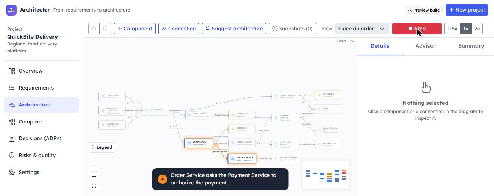
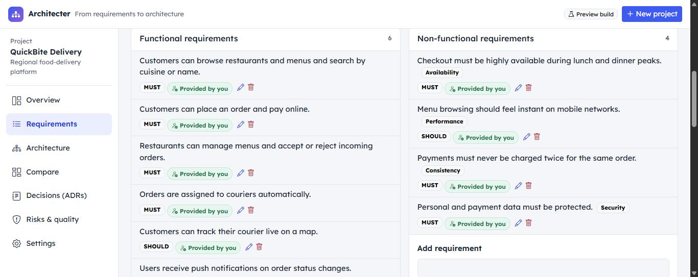
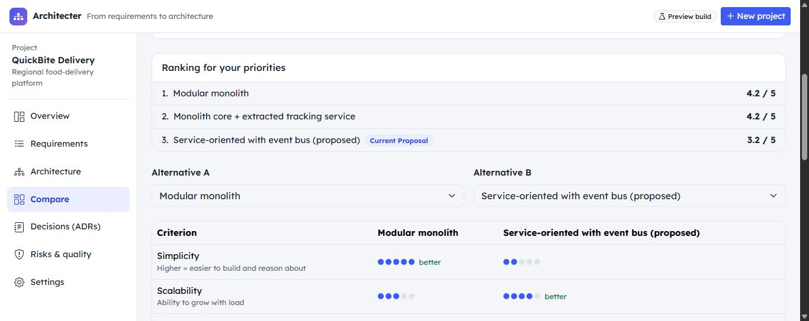
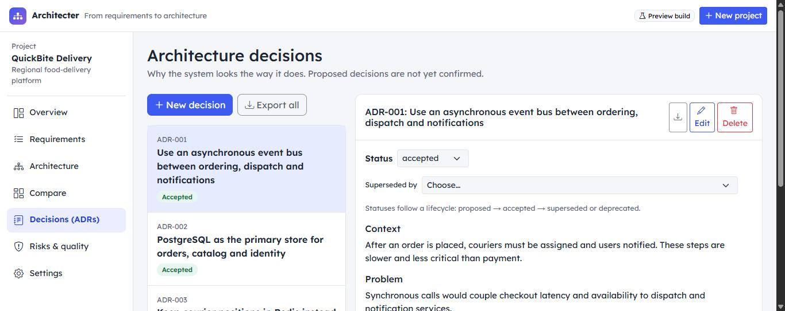
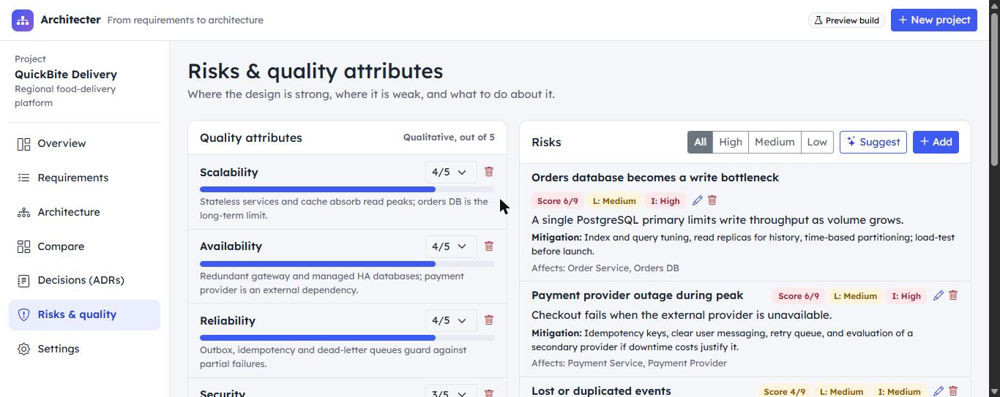
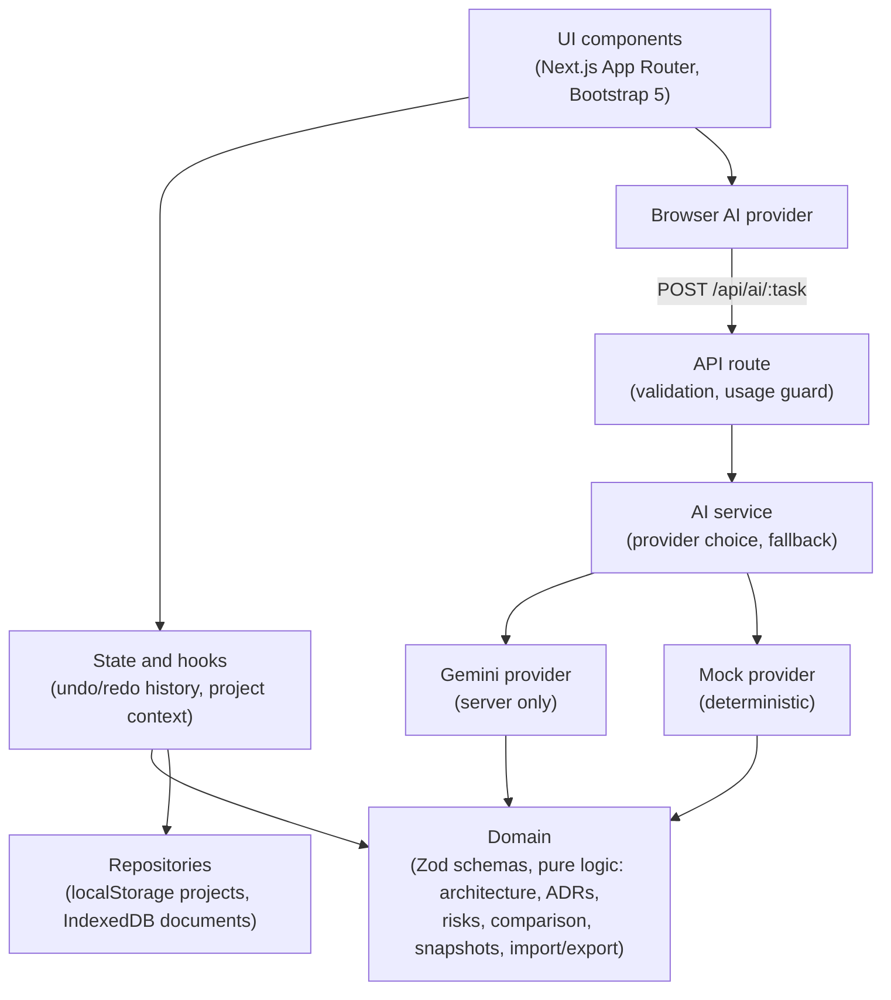
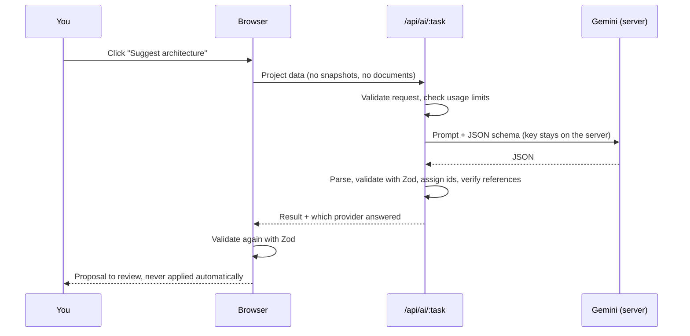

# Architecter

**From requirements to architecture.**

Architecter is an AI-assisted **system design studio**. You describe a product, state what you know about it, and Architecter helps you turn that into a structured, visual and defensible software architecture: components, connections, trade-offs, decisions and risks.

It is a practical engineering tool, not a chatbot and not a diagram generator. The project is a structured document (requirements, components, relationships, decisions, risks, alternatives); the diagram, the exports and the AI features are views and operations on that document.



## Contents

- [Features](#features)
- [Screenshots](#screenshots)
- [How it works](#how-it-works)
- [Technology stack](#technology-stack)
- [Getting started](#getting-started)
- [Environment variables](#environment-variables)
- [AI configuration](#ai-configuration)
- [Import, export and documents](#import-export-and-documents)
- [Testing](#testing)
- [Security and privacy](#security-and-privacy)
- [Accessibility](#accessibility)
- [Deployment](#deployment)
- [Known limitations](#known-limitations)
- [Credits and license](#credits-and-license)

## Features

**Requirements you can trust**

- Enter requirements, or upload a document (`.txt`, `.md`, `.pdf`, `.docx`) and review what was extracted before anything is added.
- Every item carries its origin: *provided by you*, *assumption*, *recommendation* or *open question*. Architecter never silently invents a critical requirement: missing information becomes a question.
- Assumptions can be confirmed or rejected. Targets such as budget or traffic are only filled in when you provide them.

**Architecture workspace**

- Interactive diagram (zoom, pan, minimap) with distinct component types, synchronous and asynchronous connections, and assumption markers.
- **Flow simulation:** pick a typical flow (for example *Place an order*) and watch a pulse of light travel along each connection, step by step, with a caption explaining what happens.
- Inspect any component or connection: responsibilities, rationale, failure mode, scaling, related risks and structural impact.
- Add, edit and delete components and connections. Deleting shows what would be affected first.
- Undo / redo and named **snapshots** you can restore.
- Architecture checks that flag orphan components, shared databases and clients bypassing the API.

**AI assistance with you in control**

- Requirements analysis, clarifying questions, architecture generation, component explanations, an architecture **advisor**, impact analysis, ADR drafts, risk suggestions and alternatives.
- AI output is always a **proposal**: architecture changes are listed change by change, you pick what to apply, a snapshot is saved first, and nothing changes until you approve.
- Every answer says which AI produced it (Gemini, the built-in mock, or a flagged fallback).

**Decisions, risks and comparison**

- Architecture Decision Records with a real lifecycle (proposed, accepted, superseded, deprecated).
- Risk register scored by likelihood and impact, and quality attributes with notes.
- Compare alternatives (for example modular monolith vs. services) with weighted criteria. Cost figures are always labelled as estimates and state their assumptions.

**Your data**

- Multiple projects saved in your browser, with duplicate, delete, export and restore.
- Workspace backups, import with validation, version checks and conflict resolution.
- Exports generated from the real project data: JSON, Markdown documentation, ADRs and Mermaid diagrams.

## Screenshots

| Requirements, with the origin of every item | Compare alternatives with weighted criteria |
| --- | --- |
|  |  |

| Architecture decision records | Risks and quality attributes |
| --- | --- |
|  |  |

## How it works

### Layers

Business logic never lives in React components, and AI never runs in the browser.



### What happens when you ask the AI something



If Gemini is not configured, fails, times out or hits a limit, the built-in mock answers instead and the interface says so.

### Domain model

The data model is defined once, as [Zod](https://zod.dev) schemas in [`src/domain/schemas.ts`](src/domain/schemas.ts); all TypeScript types are inferred from them. A project holds requirements, targets, assumptions, open questions, components, relationships, flows, ADRs, risks, quality attributes, alternatives, snapshots and source documents, and is validated as a whole (for example, a connection can never point at a component that does not exist).

### Project structure

```
src/
  app/            Next.js routes and the API route handlers (thin)
  components/     UI: diagram, panels, layout, projects, ui primitives
  domain/         Schemas, types and pure business logic (no React, no I/O)
  ai/             Provider interface, mock, Gemini provider, server service,
                  usage guard, browser client provider
  repositories/   Project storage (localStorage) and document store (IndexedDB)
  services/       Diagram layout, document text extraction
  state/          Undo/redo history, project context, hooks
  config/         Security headers
  mock/           The demo project
tests/            Vitest unit and integration tests
```

## Technology stack

| Area | Choice |
| --- | --- |
| Framework | Next.js 16 (App Router), React 19, TypeScript (strict) |
| UI | Bootstrap 5 and custom CSS, Bootstrap Icons, Lexend font |
| Diagram | [React Flow](https://reactflow.dev) with dagre layout; animation with [Motion](https://motion.dev) |
| Validation | Zod 4 |
| AI | Google Gemini through `@google/genai`, server side only, behind a provider abstraction |
| Documents | `unpdf` (PDF), `mammoth` (DOCX), `jszip`, all running in the browser |
| Storage | `localStorage` behind a repository interface; IndexedDB for original uploaded files |
| Tests | Vitest, `fake-indexeddb` |

Mermaid is used for **export only**. The diagram is rendered from the project's own data, so it can be inspected, edited and animated.

## Getting started

Requirements: **Node.js 20.9 or newer** and npm.

```bash
npm install
cp .env.example .env.local   # optional: add your Gemini key (see below)
npm run dev
```

Open <http://localhost:3000>. The app works without any configuration: with no Gemini key it uses the built-in mock AI and says so in the interface. A demo project (*QuickBite Delivery*) is added the first time you open it.

### Scripts

| Command | What it does |
| --- | --- |
| `npm run dev` | Development server |
| `npm run build` / `npm start` | Production build and server |
| `npm run lint` | ESLint |
| `npm run typecheck` | TypeScript, no emit |
| `npm test` | Unit and integration tests |
| `npm run check` | Lint, type check, tests and build, in that order |

## Environment variables

Read on the **server only** and never sent to the browser. Copy [`.env.example`](.env.example) to `.env.local` (it is git-ignored).

| Variable | Default | Meaning |
| --- | --- | --- |
| `AI_PROVIDER` | `auto` | `auto` uses Gemini when a key exists, `gemini` always tries Gemini, `mock` never calls an external API |
| `GEMINI_API_KEY` | *(empty)* | Your key from [Google AI Studio](https://aistudio.google.com/apikey) |
| `GEMINI_MODEL` | `gemini-2.5-flash` | Model name. Names change over time: check Google's documentation |
| `AI_TIMEOUT_MS` | `20000` | Timeout of one model call (1000 to 55000) |
| `AI_MAX_ATTEMPTS` | `3` | Total attempts for temporary failures, including the first (1 to 4) |
| `AI_FALLBACK_TO_MOCK` | `true` | On failure, answer with the mock (flagged) instead of returning an error |
| `AI_RATE_LIMIT_PER_MINUTE` | `10` | Gemini requests per client IP per minute. `0` disables |
| `AI_DAILY_BUDGET` | `300` | Gemini requests per UTC day for the whole deployment. `0` means unlimited |

## AI configuration

**Providers.** The app talks to an `AIProvider` interface with two implementations: a deterministic **mock** (rules over your project data, no network) and **Gemini**. The server chooses between them from the environment; the browser never sees the key.

**Structured output.** Gemini is asked for JSON that matches a schema, and the response is validated again with Zod before it reaches the application. The model never chooses identifiers, statuses or timestamps: those are assigned by the application. References the model makes (components in a connection, components in a risk) are checked against the real project, and anything that cannot be verified is dropped. For impact analysis, dependents and dependencies come from the graph itself and the model only writes the summary.

**Reliability.**

- One timeout per call and a bounded number of attempts with exponential backoff and jitter.
- Only temporary failures are retried (429 with a short wait, 5xx, network, timeouts, malformed output). Authentication errors and daily quota exhaustion fail immediately, because retrying would only waste quota.
- Malformed JSON and schema violations are rejected and retried a limited number of times.
- On failure the built-in mock answers and the interface shows a notice with the reason. Set `AI_FALLBACK_TO_MOCK=false` to return an error instead.
- Error messages shown to users never contain raw provider text, and logs never contain keys or user content. In development only, a redacted diagnostic line is printed to help configuration.

**Free-tier note.** Google's free tier has small limits (on the model used during development: 5 requests per minute and 20 per day). When the quota is used up the app falls back to the mock and says so; it is not an error in Architecter.

**Usage limits for public deployments.** Only requests that would call Gemini are counted. There is a per-client rate limit (`429` with `Retry-After`) and a global daily budget; when the budget is used up the mock answers, flagged. If the limiting code itself ever fails, the guard **fails safe**: the request is answered by the mock and the paid model is not called.

## Import, export and documents

**Projects** are stored in your browser (`localStorage`), one entry per project, so a damaged entry cannot affect the others. Entries are validated when loaded; unreadable ones are reported and kept until you decide to download or remove them. If the browser's storage is full or blocked, Architecter tells you and offers a backup download.

**Export** from the dashboard or a project's Settings: JSON backup, Markdown documentation, ADRs and a Mermaid diagram. They are generated from the project data, never from a separate AI summary.

**Import** accepts a project file or a whole-workspace backup. You see everything the file contains, and every validation problem, **before** anything is saved. If a project already exists you choose to keep both, replace it or skip it; projects are never merged. Backups from older schema versions are migrated; files from newer versions are refused with a clear message. Source documents keep their extracted text in backups, but the original files are not included.

**Documents.** `.txt`, `.md`, `.pdf` (up to 5 MB, 150 pages) and `.docx` (up to 5 MB) are read in your browser; nothing is uploaded. Files are validated by size and by their actual signature, not only their extension, and `.docx` archives are checked against zip bombs. You see the extracted text, then choose *Attach only* or *Attach and analyze*. The original file is kept untouched in IndexedDB and can be downloaded again. Extracted requirements always go through a review step.

## Testing

```bash
npm test
```

More than 250 tests cover the domain logic, schemas, import and migration, the storage layer (including corrupted data and a full browser storage), document validation and extraction with real PDF and DOCX files, the AI provider (retries, timeouts, malformed output, quota handling, fallback), the HTTP handler, the usage guard, security headers and a **full end-to-end workflow** from a description to a restored backup.

Calls to the real Gemini API are **not** part of the automated suite (they need a key and consume quota). The Gemini provider is tested against a fake model client, and was verified manually against the real API. CI runs lint, type check, tests, a production build and a dependency audit ([`.github/workflows/ci.yml`](.github/workflows/ci.yml)).

## Security and privacy

- The Gemini key is read on the server only. The browser bundle contains no key and no SDK, and a test checks it.
- All structured AI output is validated with Zod before it enters the application, and again in the browser.
- No raw HTML is ever rendered (there is no `dangerouslySetInnerHTML`; a test enforces it). Document text, AI text and exports are displayed as plain text.
- API input is validated with strict schemas and size limits. Uploaded files are validated and processed in the browser.
- Security headers on every response: a Content Security Policy that only allows this origin (production), `X-Frame-Options`, `X-Content-Type-Options`, `Referrer-Policy`, `Permissions-Policy` and HSTS.
- Your projects never leave your browser, except the project data you send to the AI when you use an AI feature. If you configure Gemini, that data is sent to Google under Google's terms.

## Accessibility

Semantic landmarks and headings, a skip link, labelled controls, a visible focus ring, native `<dialog>` modals (focus is trapped, Escape closes, focus returns to the opener), text alternatives for ratings and icons, errors announced to assistive technology, AA contrast, and `prefers-reduced-motion` respected, including in the flow animation. An automated script checked control names, labels, duplicate ids, heading order, language, landmarks and computed contrast on every screen. It has not been tested with a screen reader.

## Deployment

Architecter is a standard Next.js app and is prepared for [Vercel](https://vercel.com). Nothing is deployed automatically.

1. Push the repository to GitHub.
2. Import it in Vercel (framework preset: Next.js, defaults are fine).
3. Add the environment variables from the table above. For a public site, set at least `GEMINI_API_KEY`, `AI_RATE_LIMIT_PER_MINUTE` and `AI_DAILY_BUDGET`. Without a key the site works with the mock.
4. Deploy.

Things to know:

- The AI route allows up to 60 seconds. If your plan caps function duration below that, lower `AI_TIMEOUT_MS` and `AI_MAX_ATTEMPTS` accordingly.
- The usage guard keeps its counters **in memory of each server instance**. On serverless hosting, instances do not share counters, so limits are approximate. For strict enforcement put a shared store (for example Redis) behind the same `AIGuard` interface, or use your host's rate limiting.
- Never commit `.env.local`. Rotate the key immediately if it is ever exposed.

## Known limitations

- **Storage is per browser.** Projects live in `localStorage`: no accounts, no sync between devices, and a limit of a few MB. Back up regularly.
- **Backups exclude original documents** (only their extracted text).
- **Scanned PDFs are not supported** (no OCR), and PDFs with columns or tables may extract out of order.
- **The analysis reads at most 12,000 characters** of a document; the interface says when text is cut.
- **AI quality depends on the model** and can be wrong. Treat every proposal as a draft to review.
- **Usage limits are per instance** on serverless hosting (see above).
- The diagram is laid out automatically and nodes cannot be dragged; there are no infrastructure boundary boxes yet.
- Mobile layouts were checked at 360 px in a desktop browser, not on physical devices, and a screen reader has not been used.
- The Gemini model name and the response schema support can change on Google's side.

## Credits and license

Diagrams are rendered with [React Flow](https://reactflow.dev) (xyflow), whose attribution is left visible in the diagram corner, animated with [Motion](https://motion.dev), and laid out with [dagre](https://github.com/dagrejs/dagre). Icons are [Bootstrap Icons](https://icons.getbootstrap.com).

Released under the [MIT License](LICENSE).
